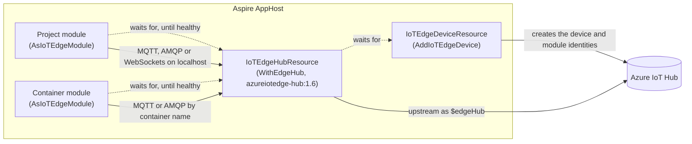
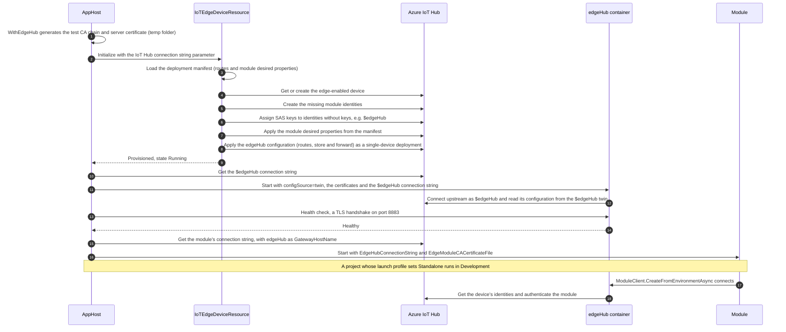
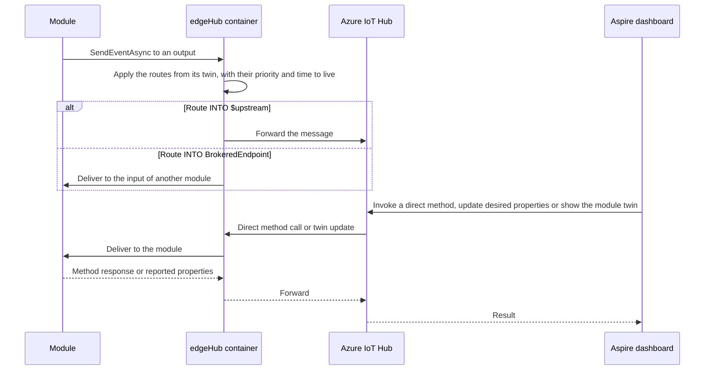

# Atc.Aspire.Hosting.Azure.IoTEdge

An [Aspire](https://aspire.dev) hosting integration for running Azure IoT Edge modules locally against a real Azure IoT Hub.

On start, the AppHost creates an edge-enabled device and a module identity for every module in the IoT Hub, or reuses them if they already exist. The modules then connect in one of two ways:

- **Through a local edgeHub** (`WithEdgeHub`): an `azureiotedge-hub:1.6` container runs next to the modules, like on a real IoT Edge device. Routes from your deployment manifest apply, so module outputs, inputs and `$upstream` work as in production.
- **Directly to IoT Hub** (no `WithEdgeHub`): each module gets its own connection string to IoT Hub. Telemetry, direct methods and twins work, but routes and module inputs do not.

Modules can be .NET projects running on the host or containers. They receive the `EdgeHubConnectionString` environment variable, which `ModuleClient.CreateFromEnvironmentAsync` reads, so module code needs no changes.

## Usage

```csharp
var builder = DistributedApplication.CreateBuilder(args);

// An IoT Hub connection string with registry read/write and service connect permissions, e.g. iothubowner.
var iotHub = builder.AddParameter("iothub-connection-string", secret: true);

var device = builder
    .AddIoTEdgeDevice("edge-device", iotHub)
    .WithDeploymentManifest("../IoTEdgeModules/deployment.template.json")
    .WithEdgeHub();

builder
    .AddProject<Projects.SimulationModule>("simulationmodule")
    .AsIoTEdgeModule(device);

builder
    .AddContainer("opcpublisher", "iotedge/opc-publisher", "2.9.18")
    .WithImageRegistry("mcr.microsoft.com")
    .AsIoTEdgeModule(device);

await builder.Build().RunAsync();
```

Set the connection string with user secrets:

```powershell
dotnet user-secrets set "Parameters:iothub-connection-string" "HostName=<hub>.azure-devices.net;SharedAccessKeyName=iothubowner;SharedAccessKey=<key>"
```

## With or without edgeHub

| Use `WithEdgeHub()` when | Leave it out when |
| --- | --- |
| Modules send messages to each other through outputs and inputs, or you want to test the routes in your deployment manifest | Modules only send telemetry to IoT Hub and use direct methods and twins |
| You want to run as close to production as possible: the same edgeHub image and routes, TLS through a gateway, and messages kept while IoT Hub is unreachable | Docker isn't available, or ports 8883, 5671 or 443 are taken on your machine |
| You want a quick answer from the connection check: edgeHub reports connected modules at once, IoT Hub can take minutes | A project module runs on macOS and shouldn't have to accept the edgeHub test certificate itself |

Without edgeHub there are fewer moving parts: no container, no certificates and no fixed ports, and each module connects to IoT Hub with its own connection string.

## API

| Method | Description |
| --- | --- |
| `AddIoTEdgeDevice(name, connectionString, deviceId?)` | Adds the emulated device. The device id defaults to `<name>-<machine name>`, so developers sharing an IoT Hub get their own device. |
| `WithDeviceId(deviceId)` | Sets the device id in IoT Hub, as text or as a parameter. With a parameter, e.g. `builder.AddParameter("edge-device-id")`, each developer can set their own device id in user secrets (`Parameters:edge-device-id`). |
| `WithDeploymentManifest(path)` | Applies a deployment manifest or template as a deployment does: the edgeHub configuration (routes with priority and time to live, store and forward) goes to the `$edgeHub` twin, and the desired properties replace those in each module twin, so a property removed from the manifest is removed from the twin. Without a manifest, edgeHub gets a configuration that routes every message upstream. |
| `WithEdgeHub(configure?, mqttPort, amqpPort, httpsPort)` | Runs a local edgeHub container with generated test certificates. |
| `WithUpstreamProtocol(protocol)` | Sets the protocol edgeHub uses to reach IoT Hub (`Amqp`, `AmqpWs`, `Mqtt`, `MqttWs`). |
| `WithDataVolume(name?)` | Keeps the edgeHub state (queued messages, cached identities) in a Docker volume across AppHost restarts. |
| `AsIoTEdgeModule(device, moduleId?)` | Runs a project or container as a module. The module id defaults to the resource name. A project whose launch profile sets the environment to `Standalone` runs in `Development` instead, so it connects instead of using the mock `ModuleClient` from `Atc.Azure.IoTEdge`. |

## Dashboard commands

- **Device**: delete the device and its module identities from IoT Hub. Its edgeHub and modules are stopped, because their keys no longer work, and the device shows **Deleted** until the AppHost restarts and provisions it again.
- **Module**: invoke a direct method, update the twin's desired properties, show the module twin, and check the connection.

## Checks

The integration stops resources that clearly can't be IoT Edge modules, and warns about likely mistakes.

| Check | When | Result |
| --- | --- | --- |
| Device and module ids follow the IoT Hub rules: up to 128 letters, digits and `- . % _ * ? ! ( ) , : = @ $ '` | `AddIoTEdgeDevice`, `WithDeviceId`, `AsIoTEdgeModule` | `ArgumentException` |
| Module ids don't start with `$`, which is reserved for `$edgeAgent` and `$edgeHub` | `AsIoTEdgeModule` | `ArgumentException` |
| A module id is used only once per device | `AsIoTEdgeModule` | `InvalidOperationException` |
| A resource is attached as a module only once, to one device | `AsIoTEdgeModule` | `InvalidOperationException` |
| Every module is declared in the deployment manifest, so its routes and desired properties apply | Device start | The device fails to start |
| The manifest's `$edgeHub` configuration has a `schemaVersion`, without which edgeHub rejects it and runs without routes | Device start, with `WithEdgeHub` | The device fails to start |
| The device id isn't used by a real IoT Edge runtime (its `$edgeAgent` twin has no reported properties), whose modules the single-device deployment would remove | Device start, before anything is changed in IoT Hub | The device fails to start |
| A container module runs the image the manifest declares for it (registry and tag are ignored, as are template placeholders like `${MODULES.x}`) | Device start | Warning in the device log |
| A project module references the IoT device SDK (`Microsoft.Azure.Devices.Client`), read from its `obj/project.assets.json` | Device start | Warning in the device log |
| A module connects after it starts | About a minute after each module start | `iotedge.connection` property and the module log |

The connection check reads which clients edgeHub reports in its twin, or, without an edgeHub, the connection state IoT Hub reports for each module. IoT Hub can take a few minutes to update the latter, so it's only logged as information. Every read counts against the IoT Hub daily quota, so a module start costs at most six reads, shared by all modules of the device, and the check stops as soon as the module is connected. Use the **Check connection** command to check again later.

When IoT Hub refuses a call, for example because of a wrong key, the device fails to start with IoT Hub's error in its log, and a command fails with IoT Hub's error in its result.

## Flow

### Resources

The device is a custom resource without a process: it provisions identities in IoT Hub. The edgeHub is a container that is a child of the device. The modules are your own projects or containers, marked with `AsIoTEdgeModule`.



Without `WithEdgeHub`, there is no edgeHub container, and each module connects directly to IoT Hub with its own connection string.

### Start-up



### Messages and dashboard commands



## How the edgeHub mode works

- edgeHub runs with `configSource=twin`, as on a real device: it reads its routes and store and forward settings from the desired properties of its `$edgeHub` twin, and reports its connected clients in the reported properties. Provisioning applies that configuration from the deployment manifest, or a default that routes every message upstream, as a single-device deployment at each AppHost start, like `az iot edge set-modules`: IoT Hub only lets a deployment write the twins of `$edgeAgent` and `$edgeHub`. Its `$edgeAgent` part lists only the system modules, because Aspire, not edgeAgent, decides what runs, so the portal shows no custom modules in the device's deployment. edgeHub authenticates to IoT Hub with the `$edgeHub` module identity of the device.
- A test CA chain (device CA, edgeHub CA, server certificate) is generated per device in `atc-aspire-iotedge` under the temp folder. Its SANs cover the container name, `localhost` and `host.docker.internal`. Modules get `EdgeModuleCACertificateFile` pointing at the device CA. On macOS this is skipped for modules running on the host, so they must accept the edgeHub certificate themselves (pass `ServerCertificateValidation.AcceptAny` to the `TransportSettingsFactory` in `Atc.Azure.IoTEdge`).
- edgeHub publishes ports 8883 (MQTT), 5671 (AMQP) and 443 (WebSockets) on the host, because the IoT device SDK always connects on these fixed ports. Modules running on the host connect to `localhost`, and container modules connect to the edgeHub container by name. If port 443 is taken, pass `httpsPort: null` and use MQTT or AMQP over TCP in your modules.
- Modules wait until edgeHub accepts TLS connections before they start.
- Route `priority` and `timeToLiveSecs`, and the manifest's `storeAndForwardConfiguration.timeToLiveSecs`, apply as on a real device.
- edgeHub keeps its state in the container, so messages queued while IoT Hub is unreachable are lost when the AppHost restarts. Add `WithDataVolume()` to the edgeHub to keep them.
- Only one edgeHub per AppHost can use the standard ports. A second device needs other ports in `WithEdgeHub`, and then only container modules can reach its edgeHub.

## Limitations

- Cloud-to-device messages are not supported for modules, by IoT Hub itself.
- edgeAgent is not emulated, so the `$edgeAgent` direct methods (restart module, get logs) do not work, and the module images in the deployment manifest are not used. Aspire decides what runs.
- With direct connections (no edgeHub), `SendEventAsync` to an output goes straight to IoT Hub, and module inputs receive nothing.